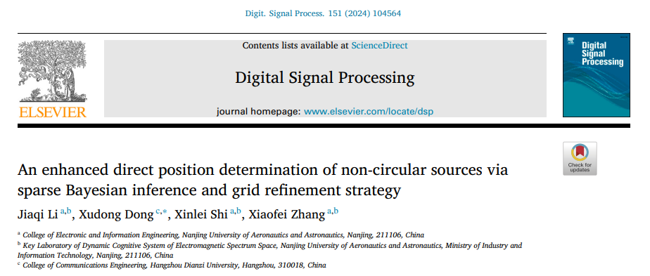
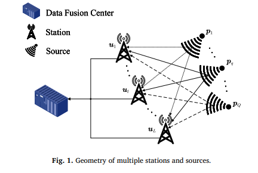
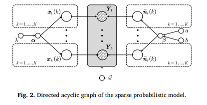
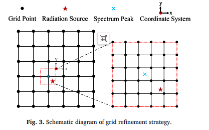
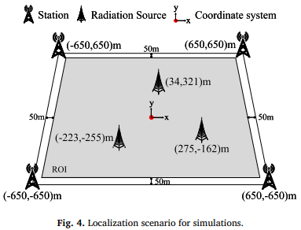
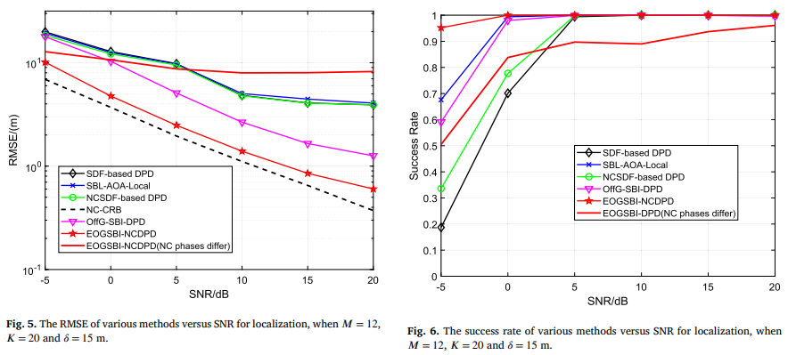
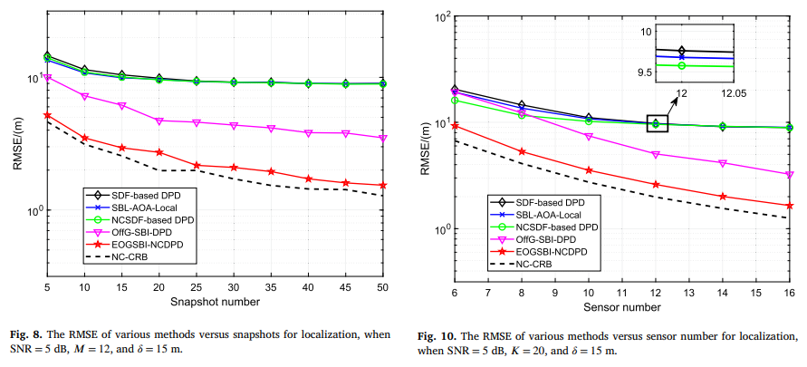
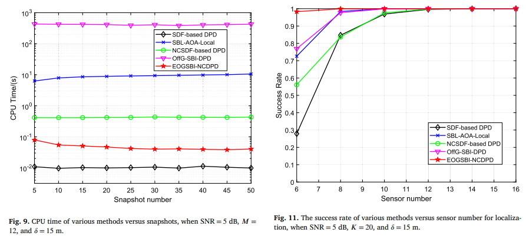
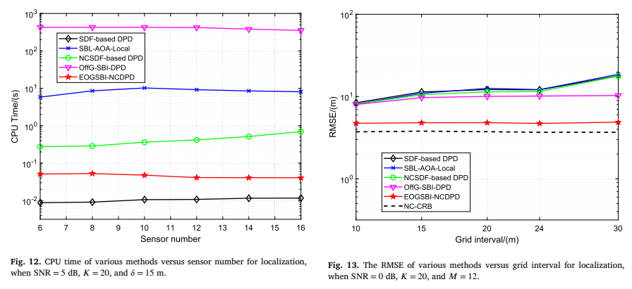

# [DOA Estimation] Spectrum of Non-circular Source Enhanced Direct Localization Algorithm Based on Sparse Bayesian Inference and Grid Refinement Strategy

Non-circular source enhancement direct positioning algorithm based on sparse Bayesian inference and grid refinement strategy
Article Information Journal: Digital Signal Processing 151 (2024) 104564 Authors: Jiaqi Li, Xudong Dong, Xinlei Shi, Xiaofei Zhang Institutions: Nanjing University of Aeronautics and Astronautics, Hangzhou Dianzi University
I. Abstract: This paper investigates a novel Direct Position Determination (DPD) algorithm based on Off-Grid Sparse Bayesian Inference (OGSBI). Existing DPD algorithms based on Sparse Bayesian Inference (SBI) suffer from high computational load and underutilization of non-circular (NC) signal characteristics. To address these limitations, this paper proposes an enhanced OGSBI-DPD algorithm for multiple non-circular sources.
1  
Utilize the conjugate information of non-circular signals to expand the dimension of data matrix, significantly improves positioning accuracy.
2  
Design a grid refinement strategy, first coarse search to determine the approximate position of the source, then use an encrypted grid for fine-grained positioning, effectively reducing computational load.
3  
Deduced the algorithm's computational complexity and Cramér-Rao lower bound (CRLB), completed theoretical performance analysis. Numerical simulation verification: The proposed algorithm outperforms the existing mainstream algorithms in terms of positioning accuracy and computational efficiency.
Keywords: Direct Position Determination (DPD); Non-circular Signal; Grid Refinement; Sparse Bayesian Inference; Offline Model
II. Introduction 1. Research Background on Auxiliary Signal Source Localization The application of auxiliary signal source localization is widespread in fields such as vehicle communication, underwater acoustic detection, and wireless communication. The traditional two-step localization method first estimates intermediate parameters like the angle of arrival (AOA), time of arrival (TOA), and time difference of arrival (TDOA), then calculates the position of the source through spatial geometric relationships. However, it has two inherent shortcomings:
Ignore the inherent constraints of measurement values for the same transmitter;
There is a difficulty in data correlation between base stations in different locations, requiring precise matching of parameters and sources.
2. Direct Position Determination (DPD) technology is proposed to address the shortcomings of two-step methods by scholar Weiss, who first introduced the concept of direct position determination (DPD): The data fusion center directly estimates the source's position using the original received data from the base station, without the need for intermediate parameters or data correlation, achieving significantly better positioning performance in low signal-to-noise ratio scenarios compared to two-step methods.
In modern communication, non-circular complex signals such as MASK, BPSK, OQPSK are more prevalent than circular ones. Research has confirmed that exploring the non-conjugate statistical characteristics of non-circular signals can further enhance the positioning performance of DPD.
3. Existing algorithms are insufficient
Sparse representation DPD algorithm based on norm: problems such as structural error, convergence to local optimal solution, and difficulty in regulating regularization parameter.
2  
Sparse Bayesian Learning (SBL) Algorithms: Global Optimal Fit to Sparse Solutions, Fewer Local Minima, but Existing SBI-DPD Multi-Focusing Spherical Signal Sources do not explore non-spherical signal gains.
3  
Offline grid mismatch problem: The real source is distributed continuously, and the discrete grid will easily occur grid mismatch. The encryption grid will increase the computational burden sharply.
4  
Lack of efficient grid optimization strategies: existing SBI-DPD iterations require updating a large number of irrelevant grid points, which is time-consuming.
4. Main Contributions of this paper 1
Extracting the Characteristics of Non-circular Signals: By utilizing the non-zero properties of the elliptical covariance of non-circular signals, we concatenate the received signal and its conjugate to expand the dimension of the data matrix, effectively increasing the number of elements in the array, significantly improving estimation accuracy.
2  
Proposes a two-dimensional grid refinement strategy: avoid redundant grid point update in SBL iteration, combined with SVD data dimensionality reduction technology, significantly reduce the computational complexity.
3  
First-order Taylor expansion fitting to offset off-grid deviations: Linearly approximates the distance from the true source to the nearest grid point, effectively solving the issue of grid mismatch.
III. Methodology 3.1 Non-circular Signal DPD Data Model 1
Scenario Model: Q radiating sources, L fixed base stations, each base station equipped with M uniform linear arrays, receiving K quick-shot data.
2  
Non-circular signal characteristics: Strict maximum non-circularity signals can be decomposed into real parts and a non-circular phase matrix. By utilizing the conjugate of the signal to increase dimensionality, an extended receiving model is constructed to expand the array manifold matrix dimensions.
3  
Multi-measurement Vector MMV Model: Construct a joint receiving data matrix for multiple base stations to lay the foundation for sparse representation modeling.
3.2 Offline Sparse Representation (SSR) Model 1
Locate the region ROI, discretize it into candidate grid points. In an ideal scenario, the source signal should fall on these grid points, allowing for a complete and redundant dictionary to be constructed for sparse representation.
2  
In real scenarios, there exists off-grid mismatch: Utilize the first-order Taylor expansion to linearly approximate the true position with the XY offsets of grid points, iteratively dynamically update the coordinates of grid points, and converge to obtain the optimal grid set.
3.3 Constructing a three-layer sparse probability model:
Sparse Signal Prior: Two-layer hierarchical sparse prior, which makes the edge distribution of the signal follow the Laplace distribution and enhances the sparsity focusing.
Noise Prior: Gaussian Noise Modeling, using Gamma distribution as prior for noise hyperparameters;
Dictionary parameter prior: The grid positions follow a uniform distribution of information within the region. Completely derive the joint probability density function, providing theoretical support for subsequent Bayesian inference.
3.4 Offline Sparse Bayesian Inference (OGSBI) 1
The posterior distribution of sparse signals is decomposed by the second-class maximum likelihood estimation, and then solved analytically.
2  
Introduce the EM algorithm to iteratively solve non-convex cost functions, updating sparse hyperparameters, noise precision, and grid offsets.
3  
Convert grid optimization into a constrained linear least squares problem, derive the analytical solution for grid offset, and achieve precise position correction in off-grid scenarios.
3.5 Core Strategy of Two-Dimensional Grid Refinement: First rough search, then fine search.
1  
Initial large-scale low-precision grid division, calculate the power spectrum of each grid, select the first Q spectral peaks as the refined position center;
2  
Iterate and refine by progressively narrowing the positioning area centered on the spectrum peak and increasing the grid interval.
3  
Grid fission and redistribution of sparse hyperparameters, preserving energy conservation while balancing positioning accuracy with computational efficiency.
3.6 Algorithm flowchart for the proposed EOGSBI-NCDPD:
Input multi-base station received data, base station positions, number of elements, signal-to-noise ratio (SNR), number of quick-scans, and non-circular phase;
2.
Initialize grid, hyperparameters, and noise precision, determine initial fine-tuned positioning area through grid refinement;
3.
Iterate to calculate covariance matrix, sparse mean, and variance, update hyperparameters and noise precision;
4.
Solving the least squares problem to obtain grid offset, dynamically updating grid positions until convergence;
5.
Search for power spectral peak in each region, outputting estimated source position.
3.7 Techniques for algorithm acceleration:
SVD-SBI dimensionality reduction: Singular value decomposition of received data, retain only the signal subspace, reduce the number of quick-scans to match the number of sources, suppress noise, and decrease computation load;
2.
Woodbury matrix identity: Avoid high-dimensional matrix inversion by reducing complexity;
3.
Only update grid offset corresponding to the first Q spectral peaks, discarding irrelevant grid iteration calculations.
3.8 Theoretical analysis of performance:
Complexity calculation: Derive the asymptotic complexity of the proposed algorithm, SDF-DPD, NCSDF-DPD, OffG-SBI-DPD, etc., proving that the complexity of the proposed algorithm is significantly lower than similar SBI algorithms after grid refinement;
2.
Cramer-Rao Lower Bound (CRLB): Derive the stochastic CRLB for non-circular source position estimation as a theoretical lower bound for positioning performance.
IV. Simulation experiment analysis:
4.1 Simulation scenario setup: Four base stations arranged in a rectangular layout, with a positioning area of 1200m×1200m, an initial grid interval of 15m, three intentionally placed sources at off-grid locations, using RMSE, success rate SR, CPU runtime time as evaluation metrics, Monte Carlo simulation 1000 times.
4.2 Different Signal-to-Noise Ratio (SNR) impacts the positioning accuracy and success rate of traditional subspace algorithms at low SNR significantly, but the proposed algorithm still maintains a near 100% positioning success rate.
Utilizing the non-circular characteristics + off-grid model, the proposed algorithm has the closest RMSE to NC-CRB, far superior to existing algorithms.
The grid refinement strategy allows the algorithm to control CPU time within 0.1 seconds, which is two orders of magnitude faster than traditional SBI algorithms.
4.3 The number of quick shots and the number of elements significantly influence the performance of sparse Bayesian algorithms in scenarios with few quick shots, outperforming traditional subspace algorithms.
The increase of the number of elements can continuously improve the positioning accuracy and resolution of the proposed algorithm, while traditional grid-connected algorithms are prone to performance saturation.
The algorithm time consumption of SVD dimension reduction is minimally affected by the number of samples, making it more practical for engineering applications.
4.4 The grid spacing has little effect on the positioning performance of off-grid algorithms, and adaptive correction for grid mismatch is performed.
The accuracy of the grid-connected algorithm deteriorates with an increase in the grid interval. Overly dense grids can lead to excessive coherence of the basis vectors, resulting in a collapse of recovery performance.
4.5 In the context of grid sparse conditions, the resolution of the grid-connected algorithm is unable to distinguish adjacent sources within individual grids. The proposed non-circular enhancement off-grid algorithm significantly outperforms the comparison algorithm in terms of resolution, and can still effectively distinguish small-spacing sources.
V. Conclusions
This paper proposes the enhanced off-grid sparse Bayesian Inverse Positioning (EOGSBI-NCDPD) algorithm, which integrates the characteristics of non-circular signals, off-grid model and grid refinement strategy.
2  
Utilize the conjugate of non-circular signals to increase dimensionality, equivalently expand the array aperture, and enhance positioning accuracy from a mechanism perspective.
3  
Design of 2D grid refinement strategy + SVD dimensionality reduction, significantly reduce SBI iterative computations, while maintaining high accuracy and low complexity.
4  
Simulation confirms: under complex scenarios such as low signal-to-noise ratio, few snapshots, sparse grids, and near-source signals, the proposed algorithm outperforms mainstream algorithms like SDF-DPD, NCSDF-DPD, SBL-AOA-Local, OffG-SBI-DPD in terms of positioning accuracy, success rate, resolution, and computational efficiency. It is more suitable for engineering passive positioning applications.
💡Editor's note This algorithm perfectly addresses the three major challenges faced by traditional sparse Bayesian direct positioning: large computation volume, non-use of non-circular signals, and grid mismatch. It holds high practical value in radar reconnaissance, spectrum monitoring, underwater acoustic source positioning, and Internet of Things (IoT) passive positioning scenarios, providing a new framework for direct positioning of non-circular modulated signals.

## Images

<!-- PAYMENT_BLOCK -->

## Get this dataset

- Payment link (Stripe): [Buy now](https://buy.stripe.com/3cs8yP7sY87d0vu9AB)
- Payment QR code: 

<!-- /PAYMENT_BLOCK -->
